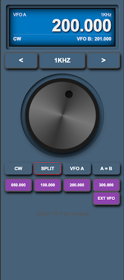
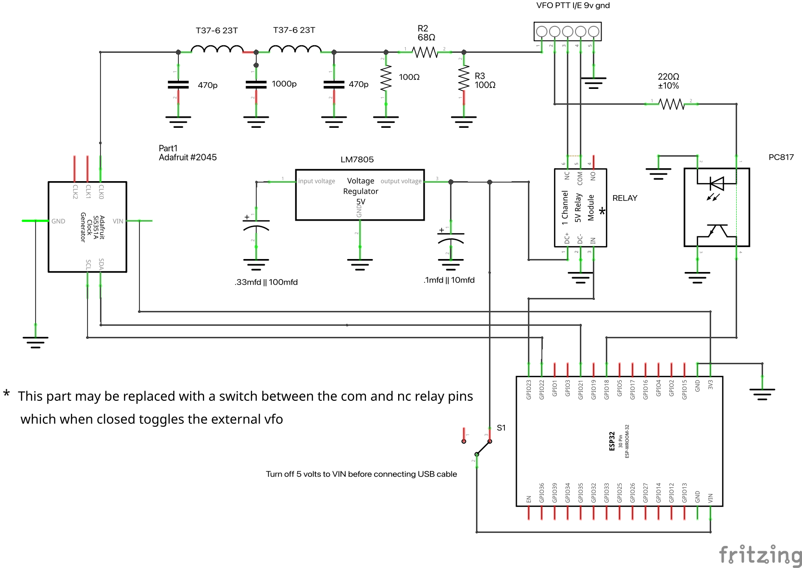

# TS830_WiFi_VFO

 

This is not a an APP per se. It is a web page produced by esp32 code and will run anywhere you can open a browser; your phone, tablet or computer.
The box containing the hardware can be left on and plugged into the EXT VFO jack of your TS-830 and can be switched easily with software or a toggle switch. The enclosure must at least expose the wifi antenna on the esp32. Frequency accuracy will improve if you properly calibrate the Si5351.

The usefulness of having a wifi VFO may be questioned and other than occasionally using split frequency and having a few memories I can’t answer that question. I will say that I like having my coffee in the morning while watching [trains](https://www.youtube.com/live/L6eG4ahJc_Q?is=0sKbtO32eBdH9FX1) on YouTube and listening to the 40 meter nets. I use a [bluetooth transmitter](https://www.amazon.com/dp/B07TLHRPDP?ref=ppx_pop_mob_ap_share) plugged into the headphone jack and a small bluetooth speaker I take with me to the living room. And I have worked split with it a time or two.

This VFO was built and tested with the Kenwood TS-830 and no other. I cannot verify its use with any other radio.
The cable and connector were bought from https://www.k4eaa.com/ca-24.htm  All DIN connectors are not the same! If in doubt, buy this one.

 

The plug wiring is as shown. The EXT VFO jack on the TS-830 has a push switch that disconnects pin 4 from pin 1 when activated
from the shell of the external DIN plug. Wiring just the connector and "trying it out" without the shell will not work since the radio will not 
know that an external VFO is being used. 

The board I used for this project is ESP-WROOM-32 https://a.co/d/02lSffuX

I used a relay board to short the 9 volts from pin 1 to pin 4 that enables or disables the external vfo  https://a.co/d/0h7P99Ec
This board could be replaced with a simple toggle switch to go from Internal (closed) to External VFO (open)

I also used an optocoupler on pin 2 to detect the 12 volts thst appears when push-to-talk is enabled https://a.co/d/067ibW73

The schematic below shows a 7mhz low pass filter followed by a 10db attenuator which should give you a bit more output than the internal vfo but easily usable without any harm.

A few notes on the operation:
Tuning can be done with the Dial or more accurately with the up and down arrows. Holding down either the up or down arrow will tune continuously.
Tapping the button in between the two arrows will change the tuning rate from 10, 100 or 1Khz.
When you find a frequency you wish to store into memory tap in the center of the frequency dial (it will turn yellow) then tap a memory button to store it.
Tapping the left side of the frequency display will toggle between full screen and not full screen.
CW/SSB button toggles between the two modes. CW provides an 800hz offset as does the internal vfo. SSB does not use an offset.
To work split tune to the receive frequency with VFO A. Tap VFO A and you will see in the upper left corner of the display that it will change to VFO B.
which will become your transmit frequency. Using the 1Khz tuning step you can easily change your tranmsit frequency. Once done press SPLIT and press VFO B. 
Make sure you are using the correct mode since CW mode will add another 800hz to your transmit frequency

 

This project was inspired by Mirko Pavleski
https://youtu.be/y8KVNp53JAg?si=wVZY4mSoWvHc5Hr7
