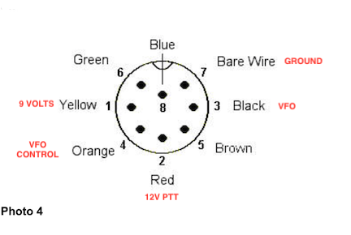

# TS830_WiFi_VFO

 

This VFO was built and tested with the Kenwood TS-830 and no other. I cannot verify its use with any other radio.
The cable and connector were bought from https://www.k4eaa.com/ca-24.htm  All DIN connectors are not the same! If in doubt, buy this one.

 

The plug wiring is as shown. The EXT VFO jack on the Ts-830 has a push switch that disconnects pin 4 from pin 1 when activated
from the shell of the external DIN plug. Wiring just the connector and "trying it out" will not work since the radio will not 
know that an external VFO is being used. 
